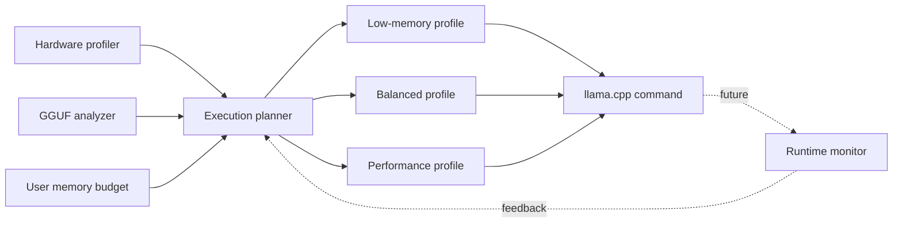

# DivideIT architecture

DivideIT is a planner and controller around local inference runtimes. Version 0.1 focuses on
planning: it never loads model tensors and therefore has a small, predictable memory footprint.

## Components

### Hardware profiler

The profiler reads total and available system memory using native operating-system interfaces.
When NVIDIA tooling is present, it also reads total and currently free VRAM. Other GPUs use a
conservative total-memory estimate when the operating system exposes one.

### GGUF analyzer

The analyzer reads only the GGUF header and metadata. It validates lengths before allocation and
supports GGUF versions 2 and 3. Large metadata arrays such as tokenizer vocabulary are streamed
and discarded.

### Memory estimator

The estimator models four major allocations:

1. CPU-resident model weights.
2. GPU-resident model weights.
3. The attention KV cache.
4. Activation buffers and runtime overhead.

It is intentionally conservative. Runtime instrumentation will eventually replace fixed buffer
margins with hardware-specific measurements.

### Execution planner

The planner creates low-memory, balanced, and performance profiles. If a profile exceeds the
host-memory budget, its context length is reduced down to a floor of 512 tokens. It then emits a
reproducible `llama-server` command.

## Current limitations

- DivideIT plans execution but does not launch or monitor llama.cpp yet.
- GPU discovery is strongest for NVIDIA hardware.
- Estimates depend on metadata completeness and backend allocation behavior.
- Dense transformer layers cannot be independently skipped during inference.

These limitations are surfaced in CLI output rather than hidden from the user.

